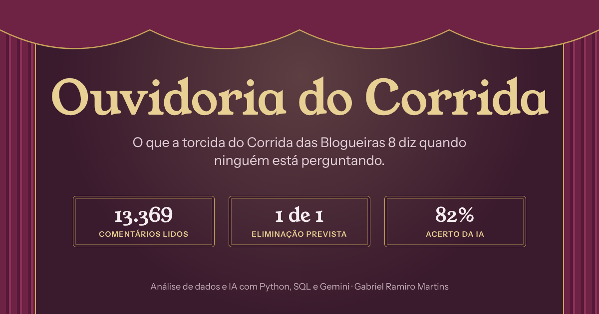

# Ouvidoria do Corrida

O que a torcida do **Corrida das Blogueiras 8** diz quando ninguém está perguntando.

**[Ver o painel ao vivo](https://aboutgabriel.github.io/ouvidoria-do-corrida/)**

[](https://aboutgabriel.github.io/ouvidoria-do-corrida/)

Projeto de dados e IA que acompanha, episódio a episódio, como a torcida reage às participantes, a partir dos comentários públicos no YouTube. Em vez de enquetes, a Ouvidoria escuta a conversa espontânea: o que milhares de pessoas escrevem sem que ninguém pergunte.

A pergunta central: **a torcida consegue prever quem sai?**

Quem sai no flop só é revelado no começo do episódio seguinte, e a janela de 48 horas fecha antes disso. Então a torcida comenta cada episódio sem saber o resultado, e o saldo funciona como uma previsão da torcida. A comparação é feita só entre quem estava no flop, porque só eles podiam sair. O eliminado é registrado em `dados/resultados.csv` no episódio do flop, mesmo que o resultado seja revelado no episódio seguinte.

> Projeto em andamento, atualizado a cada episódio da temporada (outubro de 2026 a janeiro de 2027).

## O que os dados mostram até agora

Depois de 2 episódios e 13.369 comentários lidos (as primeiras 48 horas de cada episódio):

- **A torcida acertou a primeira eliminação.** No flop do episódio 1 estavam Peter, Talitah, Aysha e Breia. Peter tinha o pior saldo entre os quatro (−75) e foi quem saiu, revelado só no começo do episódio 2. Com uma eliminação só, ainda é cedo para conclusões.
- **No episódio 2 não há previsão para testar:** Paizinho desistiu durante a prova do flop, então a torcida já sabia quem ia sair. A saída dele é anunciada no começo do episódio 3.
- **As viradas foram quase do mesmo tamanho, em sentidos opostos:** Matthel caiu de +56 para −51 depois da discussão sobre etarismo com Talitah, e Bárbara Freitas subiu de −27 para +79 depois de vencer a prova.
- **Paizinho dos Looks liderou a conversa do episódio 2** (853 menções), e 70% dos comentários foram críticas, principalmente pela desistência no meio da prova do flop.
- **Latyffa Romayale é quase unanimidade:** 192 elogios e só 4 críticas no episódio 2.

**Janela de 48 horas:** cada episódio conta só os comentários publicados nas primeiras 48 horas depois que o vídeo sai. Assim todos os episódios são comparados com a mesma régua, e o painel sai dois dias depois do episódio. No episódio 1, que tem 11 dias de comentários, o saldo de cada participante com mais de 100 menções nas primeiras 48 horas ficou a no máximo 6 pontos do saldo final (`janela.py`).

O **saldo da torcida** vai de −100 (só críticas) a +100 (só elogios) e é calculado como (elogios − críticas) ÷ menções × 100.

## Etapas

1. **Coleta** (`coletar.py`): baixa os comentários de cada episódio pela API oficial do YouTube e salva em SQLite.
2. **Verificação de apelidos** (`verificar_apelidos.py`): mede quais formas de chamar cada participante a torcida realmente usa.
3. **Classificação com IA** (`classificar.py`): o Gemini identifica quais participantes cada comentário cita e o sentimento **para cada uma delas** (análise de sentimento por aspecto), já que um mesmo comentário pode elogiar uma e criticar outra. O prompt inclui um dicionário do programa (`dados/dicionario.csv`), com gírias e referências da torcida, como "flop", "entregou" e "deitei". A saída é validada antes de ir para o banco.
4. **Avaliação** (`gerar_amostra.py` e `avaliar.py`): uma amostra sorteada de menções é revisada à mão, às cegas (a planilha não mostra a resposta do modelo), e comparada com a classificação do Gemini. Os critérios da revisão estão no [guia de anotação](GUIA_DE_ANOTACAO.md). Os números também são conferidos por um segundo caminho, em SQL puro (`conferir.py`).
5. **Temas** (`temas.py`): para cada participante em cada episódio, o Gemini lê todas as menções, define de 3 a 6 temas (por exemplo, "Discussão com Talitah sobre idade") e coloca cada menção em um deles. Assim dá para dizer do que são as críticas com números reais ("62 das 159 críticas falam de..."), em vez de generalizar a partir dos comentários mais curtidos. As fichas do painel mostram os temas com as contagens e um exemplo de cada.
6. **Resumos da percepção** (`resumir.py`): o Gemini escreve um resumo curto de como a torcida viu cada participante, a partir dos saldos, dos comentários mais curtidos e de um resumo do que aconteceu com ela em cada episódio (`dados/contexto.json`, escrito à mão a partir da transcrição). O contexto faz o resumo dizer a que momento cada comentário se refere ("criticaram o nervosismo na apresentação do gloss", e não "criticaram a comunicação"), mas a reação da torcida continua vindo só dos comentários. O Gemini também escreve um resumo de como a torcida recebeu cada episódio, a partir dos números, das cenas mais comentadas e dos 30 comentários mais curtidos do episódio. As regras do prompt proíbem opinião própria, temas citados em um comentário só e qualquer menção a corpo, saúde ou vida pessoal. **Todo resumo passa por revisão humana antes de ir ao ar**, e os corrigidos à mão ficam em `dados/resumos.json`.
7. **Painel** (`gerar_dados.py` e `docs/`): calcula, com pandas, menções e saldo da torcida por participante e episódio, e alimenta um painel em HTML, CSS e JavaScript puros, publicado no GitHub Pages.

## Resultado da avaliação

A avaliação foi feita em duas rodadas, sempre às cegas.

| Rodada | Menções | Participante certa | Sentimento igual ao humano |
|---|---|---|---|
| 1: modelo sem dicionário | 100 | 100% | 83% (margem de cerca de 7 pontos) |
| 2: modelo com dicionário, amostra nova | 50 | 100% | **86%** (margem de cerca de 10 pontos) |

**Como o dicionário foi testado:** os erros da rodada 1 mostraram onde o modelo tropeçava (gírias como "entregou", ironia, defesas lidas como crítica). Com base neles foi montado um dicionário do programa. Nas mesmas 100 menções da rodada 1, o acerto foi de 83% sem dicionário para 90% com ele. Rodar de novo o prompt sem dicionário deu 86%, o que mostra que parte da diferença é variação natural do modelo. E o 90% é otimista, porque o dicionário foi feito olhando para esses erros. Por isso a rodada 2 usa 50 menções novas, sorteadas depois, sem nenhum comentário da rodada 1. É esse o número publicado no painel (`testar_dicionario.py`).

Na rodada 2, das 47 menções que a revisão marcou como elogio ou crítica, só 2 foram lidas pelo modelo com o sentido trocado. A maioria das divergências fica entre neutro e elogio ou crítica.

## Dados

- `dados/participantes.json`: as 12 participantes e as formas como são citadas.
- `dados/dicionario.csv`: gírias, bordões e referências da torcida, com o sentido de cada um, que vão no prompt do classificador.
- `dados/eliminacoes.csv`: se o flop de cada episódio teve eliminação. Um episódio sem linha aqui é tratado como resultado ainda não revelado, e o painel mostra a aposta da torcida.
- `dados/resultados.csv`: resultados oficiais por episódio (Venceu, Salvo, Flop, Eliminado, Desistiu).
- `dados/resumos.json`: resumos da percepção da torcida sobre cada participante, revisados à mão.
- `dados/resumos_episodios.json`: resumos de como a torcida recebeu cada episódio, revisados à mão.
- `dados/correcoes.csv`: correções da revisão humana em comentários que aparecem no painel, com o motivo de cada uma (`corrigir.py`). Não mudam a taxa de acerto publicada, que vem só da amostra às cegas.
- `dados/citacoes_ocultas.csv`: comentários que continuam contando nos números, mas não aparecem em destaque no painel (por exemplo, piadas que associam uma participante a drogas).
- `dados/cenas.json`: o que acontece em cada cena mais comentada, escrito à mão a partir da transcrição do episódio.
- `dados/contexto.json`: o que aconteceu com cada participante em cada episódio (prova, dupla, resultado, conflitos), escrito à mão a partir da transcrição. Vai para o prompt dos resumos. Os "ganchos" (o fato principal de cada participante numa frase curta) entram nos textos automáticos do painel, como a manchete e as viradas: "Matthel perdeu a torcida depois de discutir com Talitah sobre etarismo".
- `docs/fotos/`: fotos oficiais das participantes (DiaTV/divulgação). O painel encontra cada foto pelo nome do arquivo (ex.: `talitah-sampaio.jpg`) e mostra as iniciais quando não há foto.
- O banco `dados/corrida.db` é gerado localmente e não vai para o repositório.

**Privacidade:** o projeto não guarda nomes de usuários. As citações publicadas aparecem sem autor, sem @menções e sem links.

## Como rodar

```bash
python -m venv .venv
.\.venv\Scripts\activate        # Windows
pip install -r requirements.txt
```

Copie `.env.example` para `.env` e coloque suas chaves da YouTube Data API v3 e do Gemini. Depois:

```bash
python coletar.py --episodio 1 --video LINK_DO_EPISODIO_1
python verificar_apelidos.py
python classificar.py --limite 40   # teste
python classificar.py               # todos
python gerar_amostra.py --rodada 2 --tamanho 50  # planilha nova para revisão humana
python avaliar.py --rodada 2                     # depois de revisar a planilha
python conferir.py                  # confere os números em SQL
python temas.py                     # temas de todas as menções
python resumir.py                   # resumos de quem tem episódio novo
python gerar_dados.py               # atualiza o painel em docs/
```

## A cada episódio novo

1. Dois dias depois do episódio sair, coletar e classificar os comentários.
2. Atualizar `dados/resultados.csv` com o resultado oficial.
3. Ler a transcrição do episódio, descrever as cenas mais comentadas em `dados/cenas.json` e escrever o que aconteceu com cada participante em `dados/contexto.json`.
4. Rodar `temas.py` e depois `resumir.py` (ele usa as cenas, o contexto e os temas) e revisar os resumos e os exemplos dos temas antes de publicar.
5. Rodar `gerar_dados.py` e publicar.
6. Atualizar `dados/proximo_episodio.json` com o número e as datas do episódio seguinte. O painel mostra uma aba "em breve" com o dia e a hora do próximo relatório.

A coleta deve ser feita depois que as 48 horas fecharem. Se for antes, o `gerar_dados.py` avisa que a janela ainda está aberta e o painel mostra os números como parciais.

## Limitações conhecidas

- **Só YouTube.** Os números mostram a torcida que comenta no YouTube, não o público inteiro. O que se diz no X, no Instagram e no TikTok fica de fora.
- A API do YouTube devolve no máximo 5 respostas por comentário, então conversas longas ficam incompletas.
- Só vão para o modelo os comentários que citam alguma participante pelo nome ou apelido. Comentários como "ela foi injustiçada", sem nome, ficam de fora.
- A torcida erra muito a grafia dos nomes. A lista de apelidos foi construída a partir dos próprios dados (ex.: "Talita" aparece mais que o oficial "Talitah").
- O modelo às vezes lê a defesa de uma participante ("injusto ela ir pro flop") como crítica a ela. Isso pode puxar para baixo o saldo de quem foi para o flop. As citações em destaque no painel são revisadas à mão (`dados/correcoes.csv`), mas a contagem geral carrega esse tipo de erro, que está incluído na taxa de acerto de 86%.
- Participantes com poucas menções têm saldo menos estável, porque cada comentário pesa mais.

## Tecnologias

Python, SQLite, YouTube Data API v3, API do Gemini (saída em JSON estruturado), pandas e HTML/CSS/JavaScript para o painel.

## Autor

**Gabriel Ramiro Martins**
[LinkedIn](https://linkedin.com/in/gabriel-ramiro-martins) · [GitHub](https://github.com/aboutgabriel)

Projeto independente, sem vínculo com a DiaTV ou com a produção do programa.
